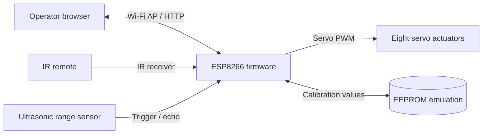
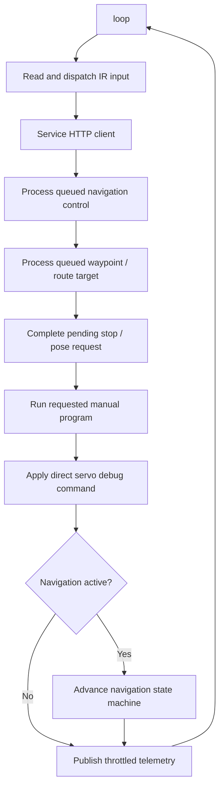
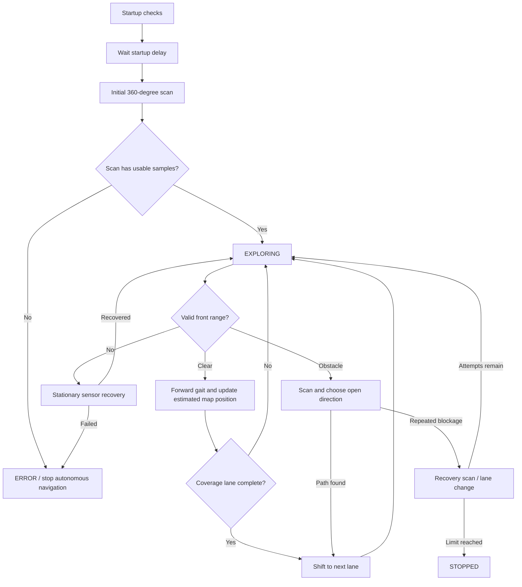

# SpiderBot Architecture

## 1. Purpose and scope

SpiderBot is an Arduino-based quadruped robot controller with an ESP8266 Wi-Fi
access point, an embedded web dashboard, manual actions, and sensor-guided
autonomous navigation. The firmware combines three main concerns:

1. **Motion execution** — playback of servo keyframe programs.
2. **Navigation** — obstacle sensing, estimated pose, a local occupancy map,
   autonomous coverage, and waypoint navigation.
3. **Operator control** — a browser dashboard and HTTP API, plus infrared
   remote input.

The design is a single-threaded embedded application. The Arduino `loop()`
dispatches input, services HTTP requests, and advances navigation; motion
programs are synchronous but periodically service the web server so requests
and stop signals can be handled during a gait.

## 2. System context



The firmware estimates movement from completed gait commands. It has no
inertial measurement unit, wheel encoders, or other independent pose sensor in
the code. Consequently, heading, distance, route progress, and map position
are estimates, not closed-loop measurements of the robot's actual pose.

## 2.1 Wiring schematic

The following is the logical pin wiring specified by the firmware. `GPIOx`
means the ESP8266 GPIO number; board silkscreen labels such as `D1` vary by
ESP8266 module and should be checked against that board's pinout before
connecting wires.

```text
                                +----------------------+
                                |      ESP8266          |
                                |                      |
 Servo 0 signal  <--------------| GPIO14  (D5*)        |
 Servo 1 signal  <--------------| GPIO12  (D6*)        |
 Servo 2 signal  <--------------| GPIO13  (D7*)        |
 Servo 3 signal  <--------------| GPIO15  (D8*)        |
 Servo 4 signal  <--------------| GPIO16  (D0*)        |
 Servo 5 signal  <--------------| GPIO5   (D1*)        |
 Servo 6 signal  <--------------| GPIO4   (D2*)        |
 Servo 7 signal  <--------------| GPIO2   (D4*)        |
                                |                      |
 Ultrasonic TRIG -------------->| GPIO1 / TX           |
 Ultrasonic ECHO <--------------| GPIO3 / RX           |
                                |                      |
 IR receiver OUT -------------->| D3 / GPIO0            |
                                +----------------------+

 External servo supply +  ------> Servo power rails (all 8 servos)
 External servo supply GND ------+-------------------+
                                  |                   |
 ESP8266 GND --------------------+-------------------+--> Sensor GND
                                                      +--> IR receiver GND

 Sensor VCC <--- supply compatible with the sensor module
 IR receiver VCC <--- regulated supply compatible with the receiver
```

`*` The D-labels shown are common ESP8266 NodeMCU-style aliases for those
GPIOs; not every ESP8266 board uses the same silk labels. Use the GPIO numbers
as the firmware-level identifiers.

### Pin and connector table

| Firmware signal | ESP8266 pin | Direction at ESP | Connected device | Notes |
|---|---:|---|---|---|
| Servo 0 signal | GPIO14 | Output | Right-front foot swing | Logical channel 0. |
| Servo 1 signal | GPIO12 | Output | Right-front leg lift | Logical channel 1. |
| Servo 2 signal | GPIO13 | Output | Right-rear leg lift | Logical channel 2. |
| Servo 3 signal | GPIO15 | Output | Right-rear foot swing | Logical channel 3. |
| Servo 4 signal | GPIO16 | Output | Left-front foot swing | Logical channel 4. |
| Servo 5 signal | GPIO5 | Output | Left-front leg lift | Logical channel 5. |
| Servo 6 signal | GPIO4 | Output | Left-rear leg lift | Logical channel 6. |
| Servo 7 signal | GPIO2 | Output | Left-rear foot swing | Logical channel 7. |
| Ultrasonic TRIG | GPIO1 / TX | Output | Ultrasonic sensor TRIG | Pulsed low/high/low for each range measurement. |
| Ultrasonic ECHO | GPIO3 / RX | Input | Ultrasonic sensor ECHO | Read with `pulseIn()` and a 30 ms timeout. |
| IR receiver data | D3 / GPIO0 | Input | IR receiver OUT | Used by the ESP8266 build. ESP32-C3 conditional build uses GPIO10. |
| Ground reference | GND | — | ESP8266, servo supply, sensor, IR receiver | Grounds must share a reference for signal levels. |
| Servo power | External supply | — | Servo V+ rails | Power requirements depend on the installed servos; the firmware does not specify a supply voltage/current. |
| Sensor power | Module-dependent | — | Ultrasonic sensor VCC | Use the voltage required by the specific sensor module. |
| IR receiver power | Module-dependent | — | IR receiver VCC | Use a supply compatible with the receiver and ESP8266 signal levels. |

The code configures servo pulse limits of 400–2400 microseconds. It does not
specify or validate the power supply. Use a supply rated for the servo set and
keep servo motor current off the ESP8266 regulator; join supply ground to
ESP8266 ground. Confirm the ultrasonic module's echo voltage is safe for the
ESP8266 input before wiring it, since module output levels vary.

**UART pin conflict:** GPIO1/TX and GPIO3/RX are assigned to the ultrasonic
sensor. Enabling serial logging or attaching a serial console can therefore
interfere with range sensing unless the wiring or firmware pin assignment is
changed. GPIO0, GPIO2, GPIO15, and other ESP8266 pins also have boot-strapping
constraints; attached peripherals must not force them into invalid boot levels.

## 3. Source-file responsibilities

| File | Responsibility |
|---|---|
| [`SpiderBot.ino`](./SpiderBot.ino) | Firmware entry points, infrared command dispatch, ultrasonic measurement, navigation state machine, target handling, pose/map estimates, and navigation telemetry publication. |
| [`spiderbot_motion.h`](./spiderbot_motion.h) | `SpiderBotMotion` interface for servo setup, gaits, fractional turns, and poses. |
| [`spiderbot_motion.cpp`](./spiderbot_motion.cpp) | Servo initialization and pin mapping, EEPROM servo offsets, keyframe interpolation, forward steering correction, and motion implementations. |
| [`actionarray.h`](./actionarray.h) | Servo poses and gait keyframe matrices, including forward/backward walking, shifts, turns, and animations. |
| [`webserver.h`](./webserver.h) | Shared action IDs, navigation/API structures, telemetry shape, and cross-module function declarations. |
| [`webserver.cpp`](./webserver.cpp) | ESP8266 SoftAP and HTTP server, embedded HTML/CSS/JavaScript dashboard, REST-style APIs, navigation command queues, and persistent calibration values. |

## 4. Runtime architecture

### 4.1 Startup

`setup()` performs the following sequence:

1. Enables optional debug serial output and starts the IR receiver.
2. Configures the ultrasonic trigger and echo pins.
3. Starts the Wi-Fi access point and HTTP server.
4. Initializes all eight servo channels and moves them to the configured zero
   pose.
5. Takes an ultrasonic reading and retries sensor recovery if necessary.
6. On successful Wi-Fi and sensor startup, enters a five-second
   `STARTUP_DELAY`; otherwise autonomous navigation is disabled and the
   navigation state reports an error.

The AP name includes the last two bytes of the ESP's MAC address. The AP
credential is configured in firmware. The dashboard and API are served
directly from the device; there is no external web server or build-time web
asset pipeline.

### 4.2 Main loop and action dispatch



Manual action IDs are shared by the web UI, API, and IR mapping. They cover
standby, forward/backward, left/right shift, left/right turn, lie, hello,
fighting, push-up, sleep, three dances, and Avoid mode. The code also provides
center and zero-pose commands.

Manual actions pause autonomous navigation. The web/API command path places a
requested program in `Servo_PROGRAM`; the main loop runs it through
`runRobotProgram()`. Stop requests are checked by the motion playback loop and
can end a gait before its keyframes finish.

### 4.3 Motion layer

`SpiderBotMotion` owns eight servo objects and maps logical matrix columns to
the configured GPIO channels. `actionarray.h` describes each gait as a
sequence of eight servo targets plus a duration. The motion layer interpolates
from the cached servo positions toward each keyframe, applies per-servo
EEPROM offsets, and services the HTTP client while animating.

The forward gait represents an estimated 8 cm step. A completed forward gait
may be followed by a fractional turn gait when forward steering correction is
non-zero. Fractional turn methods scale the turn keyframe amplitudes from the
turn gait's baseline pose; they do not measure actual angle.

## 5. Autonomous navigation

### 5.1 Navigation states

| State | Role |
|---|---|
| `INITIALIZING` | Initial firmware state. |
| `STARTUP_DELAY` | Wait before enabling autonomous behavior. |
| `INITIAL_SCANNING` | Rotate in calibrated steps, sample range, and build initial map data. |
| `EXPLORING` | Check forward range and walk forward when clear. |
| `AVOIDING_OBSTACLE` | Scan around an obstacle and select an open direction. |
| `REPOSITIONING` | Shift into the next coverage lane. |
| `RECOVERING` | Retry a blocked route or invalid sensor readings. |
| `TARGETING` | Move toward the active waypoint, route point, or home. |
| `PAUSED` | Hold navigation until the operator resumes or restarts. |
| `STOPPED` | Stop after recovery limits are exhausted. |
| `ERROR` | Report a startup, sensor, or navigation failure. |

### 5.2 Coverage and obstacle handling

The default coverage parameters are:

| Parameter | Current value |
|---|---:|
| Forward step distance used for estimates | 8 cm |
| Nominal turn gait angle | 18.70° |
| Safe-turn distance | 30 cm |
| Forward steps per coverage lane | 12 |
| Lane spacing | 2 forward gait steps |
| Blocked cycles before recovery | 5 |
| Maximum recovery attempts | 3 |
| Invalid sensor cycles before recovery | 5 |

When exploring, the controller reads the ultrasonic sensor. A valid range below
the safe-turn distance is treated as an obstacle. The robot centers, performs a
360° scan, compares scan samples from both sides, and attempts to change lanes.
If obstruction persists, recovery is attempted; after the configured limit,
navigation stops.

An invalid or timed-out ultrasonic reading is treated as unavailable, not as a
clear path. Recovery retries the sensor while the robot is stationary. If
recovery fails, autonomous motion is disabled.



The 360° scan is resumable when interrupted by a navigation command: its
remaining turn steps are retained in RAM. Each scan step samples the current
heading and distance before turning.

### 5.3 Waypoints, routes, and return home

The dashboard lets an operator select a map point, queue a route of up to 12
points, associate supported animations with points, pause/resume navigation,
or return to the origin. Navigation targets are validated for numeric bounds,
current map bounds, known obstacle cells, and supported animation IDs.

The target controller estimates the heading to the active waypoint from the
estimated world coordinates, turns toward it, and moves in forward gaits.
When a forward sensor reading indicates an obstacle, it scans and selects a
candidate detour heading. This is local scan-guided steering; it is not a
general graph search over the occupancy grid.

At a waypoint, its optional animation is played. A route continues to its next
point; reaching the final destination pauses navigation. A single animated
destination resumes autonomous coverage after the animation. Return-home is
represented as a target at world coordinate `(0, 0)`.

### 5.4 Heading, calibration, and movement accounting

Explicit rotations from manual control and navigation use `rotateByDegrees()`.
It reads one persistent 360° calibration scale, converts the requested
physical angle into a command angle, then splits the result into nominal
18.70° gait units plus a fractional final gait. Full-circle scans use the
same calibration scale and `performTurnStep()` directly. The software updates
estimated heading using the scale. Forward steering correction is a separate
persistent value in degrees per meter; it applies a small opposite fractional
turn gait after each forward gait.

Both calibrations rely on gait-based estimates:

- The turn calibration is based on a measured 360° result and assumes that the
  correction scales linearly to smaller turns and behaves similarly in both
  directions.
- The forward correction assumes a degrees-per-meter effect and applies it
  after each 8 cm forward gait.

Actual heading and travel are not measured by an encoder or IMU. Servo
mechanics, floor friction, gait amplitude scaling, battery level, and payload
can cause actual movement to differ from the displayed estimate.

## 6. Mapping and telemetry

The navigation module maintains a **31 × 31** occupancy grid with a nominal
10 cm cell size. It starts with the robot at the grid origin. Range samples
mark intermediate cells as observed clear and the measured endpoint as an
obstacle; completed gaits mark the estimated path and robot position.

| Grid value | API symbol | Meaning |
|---|---|---|
| Unknown | `?` | No observation recorded. |
| Free | `.` | Observed clear along a range ray. |
| Obstacle | `#` | Range endpoint marked as an obstacle. |
| Path | `+` | Estimated path traveled. |
| Robot | `R` | Estimated current robot cell. |

As the robot approaches the edge of the map, the grid is shifted to keep the
robot near its center. Map offsets preserve the relationship between grid
cells and world coordinates so dashboard points remain anchored. The home
marker is drawn by the dashboard at world coordinate `(0, 0)`. Map, pose, and
scan state are held in RAM; the code does not persist the map between resets.

Navigation telemetry is copied from the firmware into a shared structure and
published at most every 500 ms, with navigation events and turn updates able
to force an immediate update. The `/api/v1/navigation` response includes:

- State and textual reason.
- Sensor validity and latest range.
- Estimated distance traveled, map-covered area, and heading.
- Map offsets and recovery count.
- Twelve scan-distance sectors.
- Grid dimensions, cell size, and the serialized grid.

The browser polls navigation telemetry every 500 ms and draws the miniature
map, robot heading, home marker, statistics, and transient notices. Browser
speech synthesis announces navigation-state changes when supported and
unmuted; speech is generated by the dashboard browser, not the robot hardware.

## 7. Web dashboard and HTTP API

### 7.1 Dashboard capabilities

The HTML, CSS, and JavaScript are embedded in `webserver.cpp` and served from
flash. The dashboard provides:

- Manual gait and animation controls.
- Navigation resume, pause, restart, and stop controls.
- Live mini-map, fullscreen map, robot heading, home marker, and statistics.
- Right-click and touch long-press map actions for point targets and routes.
- Optional animation selection for a point or route waypoint.
- Servo-offset, forward-steering, and turn calibration controls.
- Browser text-to-speech announcements with a mute toggle.

The debug dashboard is gated by a runtime UI flag toggled by `/debug/open` and
`/debug/close`; this is a UI gate, not an authentication system.

### 7.2 Routes

| Method and path | Purpose |
|---|---|
| `GET /` | Serve dashboard or locked page. |
| `GET /debug/open` | Enable dashboard UI and redirect to `/`. |
| `GET /debug/close` | Disable dashboard UI and redirect to `/`. |
| `GET /controller` | Queue a legacy action or direct servo command. |
| `GET /save` | Store a legacy servo-offset value. |
| `GET /setting1` | Read the eight legacy servo offsets. |
| `GET /api/v1/info` | Device metadata and supported actions. |
| `GET /api/v1/state` | Current/requested action and AP/UI status. |
| `GET /api/v1/navigation` | Navigation state, range, map, and telemetry. |
| `POST /api/v1/navigation/control` | Queue `pause`, `resume`, or `restart`. |
| `POST /api/v1/navigation/target` | Queue a `goto`, `route`, or `home` target. |
| `POST /api/v1/action` | Queue a supported manual robot action. |
| `GET /api/v1/calibration` | Read servo offsets. |
| `POST /api/v1/calibration` | Save all servo offsets. |
| `GET /api/v1/calibration/steering` | Read forward steering correction. |
| `POST /api/v1/calibration/steering` | Save forward steering correction. |
| `GET /api/v1/calibration/rotation` | Read measured and effective turn calibration. |
| `POST /api/v1/calibration/rotation` | Refine and persist turn calibration from a measured 360° result. |
| `POST /api/v1/servo` | Queue a direct servo-position command. |
| `POST /api/v1/stop` | Request stop and choose standby, center, or zero pose. |

API responses use a JSON envelope with `ok`, `code`, and `message`; successful
handlers may include `data`. Invalid requests return an HTTP error status and
an error message.

Navigation controls and targets are queued in shared firmware state and
consumed by the main loop, rather than executing a navigation operation inside
the HTTP handler. Manual actions use the `Servo_PROGRAM` request slot.

## 8. Persistent settings and state

| Setting/state | Storage | Persistence |
|---|---|---|
| Eight servo offsets | EEPROM bytes 0–7 | Persistent across reboot. |
| Forward steering correction | EEPROM byte 8 plus marker byte 9 | Persistent across reboot. |
| Last measured 360° angle | EEPROM bytes 10–11 plus marker byte 15 | Persistent across reboot. |
| Effective turn-calibration equivalent | EEPROM bytes 12–13 plus marker byte 14 | Persistent across reboot. |
| Occupancy map, pose, scan progress, and active route | RAM globals | Reset on device restart. |
| Voice mute preference | Browser `localStorage` | Local to the operator's browser. |

The calibration code calls `EEPROM.begin(512)` during Wi-Fi initialization.
Servo offsets are applied when servo targets are written. Forward and turn
calibrations are read by the motion/navigation logic when movement is
commanded.

## 9. Hardware and implementation constraints

| Component | Firmware interface |
|---|---|
| Board/network | ESP8266 Wi-Fi SoftAP with `ESP8266WebServer` on port 80. |
| Servos | Eight servo channels attached to GPIO 14, 12, 13, 15, 16, 5, 4, and 2. |
| Ultrasonic sensor | Trigger on GPIO 1 (TX), echo on GPIO 3 (RX), `pulseIn()` timeout 30 ms. |
| IR receiver | `D3` on the ESP8266 build; pin 10 under `ARDUINO_ESP32C3_DEV`. |
| Persistent storage | Arduino EEPROM emulation. |

Debug serial output is disabled by default. The ultrasonic sensor uses the
UART TX/RX pins in the current wiring, so serial diagnostics can conflict with
sensor operation if enabled without changing the wiring or design.

## 10. End-to-end behavior summary

```text
Boot
  -> Start Wi-Fi and HTTP dashboard
  -> Initialize servos and validate range sensor
  -> Wait, then scan surroundings
  -> Autonomous coverage or operator-selected target
  -> Range check before movement
  -> Execute gait, update estimated pose/map, publish telemetry
  -> Scan/reposition/recover when an obstacle or sensor fault is detected
  -> Pause or stop on operator command, destination, or recovery limit
```

The dashboard is the operator interface and telemetry consumer; the ESP8266
firmware remains the authority for action execution, navigation state, sensor
handling, and persistent calibration.
